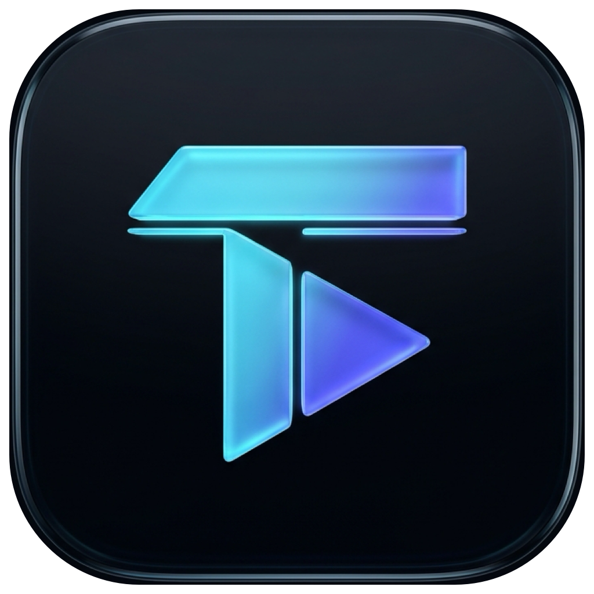

<p align="center">
  
</p>

# T-CapCut v3.0 — Obsidian Liquid Glass Video Editor + Offline Creative Ecosystem

**T-CapCut** là trình dựng phim phi tuyến (NLE) local-first dành cho macOS Apple Silicon (và Web), được phát triển từ kết quả phân tích kiến trúc `CapCut.app` kết hợp chuẩn **macOS Tahoe 2-Layer Liquid Glass HIG** (`NSGlassEffectView` cho thanh nổi/toolbar + Obsidian Matte tương phản cao cho Content/Colorist).

## Kho Nội Dung Sáng Tạo Offline Tích Hợp Sẵn (v3.0 — 100% Nhúng Trong App, Không Cần Internet)

- **36 Hiệu Ứng GPU Shader VFX (`@t-capcut/presets`) + Multi-Pass Ping-Pong FBO Stack**:
  - Xếp chồng nhiều hiệu ứng GPU đồng thời (Retro/VHS/Super 8mm/Halation, Anamorphic Flare/Prism/God Rays/Dreamy, Glitch/Datamosh/Holo/Cyber Grid, Beat Pulse/Fisheye/Kaleidoscope, Tilt-Shift/Mosaic/Frosted Glass, Duotone/Thermal/Night Vision/Sketch).
- **24 Chuyển Cảnh Dual-Texture (`[⊞]` Nút Vết Cắt Nhanh Trên Timeline)**:
  - Blend trực tiếp giữa frame cuối Clip A & frame đầu Clip B (Whip Left/Right/Up/Down, Zoom In/Out, Spin, Dip Black, Flash White, Film Burn, Light Leak, Iris Circle, Clock Wipe, Diagonal Slash, Glitch, Water Ripple, Swirl Blur) + **tùy chọn tự chèn SFX Whoosh/Glitch khớp nhịp**.
- **24 Sticker Động & Hệ Thống Hạt Bay (`Snow`, `Rain`, `Dust`, `Hearts`, `Confetti`, `Bokeh`)**:
  - Creator UI Buttons (`Subscribe + Bell`, `REC ● 4K`, `Countdown 3-2-1`, `Audio Wave HUD`, `Progress Bar`), Nhãn Sale/Rank/4K & Hiệu ứng Hạt Bay đồng nhất 100% giữa Preview & Export.
- **25 Mẫu Chữ, Karaoke Viral & Lower-Third + Animation In / Out / Loop**:
  - 8 phong cách Karaoke Viral (`Hormozi Pop`, `Classic Pill`, `Liquid Glass`, `Sweep Fill`, `Neon Cyber`, `Minimal Podcast`, `Comic Punch`, `Documentary`), 6 Intro Titles, 6 Lower-Thirds & 5 Social Review Cards.
- **16 Bộ Màu 3D `.cube` LUT Chuyên Nghiệp (Cinema, Apple/Sony/DJI Log → Rec.709, Vlog, Moody) + Local Pack Importer**:
  - Tích hợp sẵn 16 file `.cube` 17³ offline (`Kodak 2383`, `Fuji Eterna`, `CineStill 800T`, `Teal & Orange`, `Apple Log`, `Sony S-Log3`, `DJI D-Log M`, `Tokyo Cyber Neon`, `Leica B&W`...) và hỗ trợ nhập pack `.cube`/`.m4a` cá nhân.
- **15 Bài Nhạc Nền Royalty-Free (Beat Grid BPM Chính Xác + Auto Beat Markers) & 40 Creator SFX**:
  - Nghe thử Audio inline ngay trong Studio Palette trước khi kéo thả vào Timeline.
- **12 Smart Video Templates + Slot Replacement Wizard**:
  - Dựng nhanh TikTok Beat-Sync Flash, Daily Aesthetic Vlog, Hormozi Viral Talking Head, Product Commercial... chỉ với **Auto-Fill từ Media Bin**.

## Nâng cấp kiến trúc Pro NLE (v2.0 → v3.0)

- **Kiến trúc macOS Tahoe Liquid Glass + Pro NLE Ergonomics**:
  - Phân tách **Layer Chrome (Liquid Glass khúc xạ thật)** & **Layer Content (Matte tương phản cao tiết kiệm GPU)**, hỗ trợ `prefers-reduced-transparency`.
  - Native Swift 6 Shell (`WKUIDelegate` `NSOpenPanel`, **0-copy local file import**, chừa vùng traffic lights `78px`, chọn cổng động, tự nhúng runtime `node` arm64).
  - **Resizable Split Panes** kéo chỉnh cỡ mọi khung & thu gọn 1 chạm.
  - **Interactive On-Canvas Gizmo**: kéo 4 góc Scale, tay cầm Xoay (Rotate), Crop 4 cạnh, **Chroma Eyedropper hút màu trực tiếp**, đường gióng Snap tâm.
- **Timeline 120Hz Zero-ReRender & Đa Track Pro**:
  - `PlaybackClock` tách khỏi React tree → **0 React re-render** trong suốt quá trình phát 60–120fps.
  - Hỗ trợ **Compound Clips** hoàn chỉnh (play, export, double-click breadcrumb chỉnh sửa bên trong, Ungroup tách lại).
  - Kéo thả clip dọc sang track khác, **Marquee Box & Shift+Click Multi-Select**, kéo thả trực tiếp từ Media Bin & Finder, quản lý `+ Track` / `Solo (S)` / `Mute` / `Lock`, kéo/xóa **Keyframe Diamond**, **In/Out Range (`I` / `O`)**.
- **WebGL2 Compositor + Scopes + WebAudio Live Mixer**:
  - Multi-pass Custom GLSL FBO, **Heart & Star SDF**, pre-cache uniform, dirty-frame skip.
  - **Video Scopes Live** (RGB Parade & Luma Waveform) + **WebAudio Graph Engine** nghe trực tiếp âm lượng tới `200%`, Stereo Pan, Fade In/Out, Voice Preset + cột **Stereo VU Meter**.
- **Xuất Video 100% WYSIWYG + SSE Real-Time**:
  - Hỗ trợ Fast Path (`VideoToolbox` + `lut3d` + `chromakey` + `alphamerge` + **Karaoke tô từng chữ** + multi-track Audio Mix) VÀ **Exact WYSIWYG GPU Frame-Pipe** khớp từng pixel Preview ↔ MP4.
  - Thanh tiến trình SSE real-time (`%`, `fps`, `speed`), nút Hủy xuất, xuất theo vùng In/Out, và **Mở file trong Finder**.
- **On-Device AI (Apple Speech + Vision + T-ChatCut v2)**:
  - Tầng nhận diện giọng nói: `Whisper GGML` → `Parakeet CLI` → `Apple SFSpeechRecognizer` → VAD trung thực.
  - **T-ChatCut Copilot v2 (`Cmd+K`)**: thao tác theo clip chọn hoặc toàn timeline, tùy chọn kết nối **Local Ollama** / OpenAI / Gemini + Preview Ghost Diff.
- **Bảo mật & SQLite WAL JSON-Patch**:
  - Xác thực phiên `X-TCapCut-Token`, khóa CORS localhost, stream asset theo ID/allowlist, Streaming Upload 0-OOM cho video 4K nhiều GB, và nén lịch sử Undo/Redo bằng RFC 6902 JSON Patch.

## Cài đặt & Sử dụng

### Cách 1: Cài đặt trực tiếp từ file `.dmg` (macOS Apple Silicon)
1. Tải `T-CapCut-3.0.0-arm64.dmg` từ mục **Releases** (hoặc build bằng `pnpm build:app`).
2. Mở file `.dmg`, kéo **T-CapCut.app** vào thư mục **Applications** và mở ứng dụng. *(Toàn bộ 36 Shader VFX, 24 Transition, 16 `.cube` LUT, 15 Music, 40 SFX, 24 Sticker & 12 Video Template đã nhúng sẵn 100% offline. Để xuất video cần FFmpeg trên hệ thống nếu chưa cài: `brew install ffmpeg`)*

### Cách 2: Chạy từ mã nguồn (Development)
```bash
pnpm install
pnpm test        # Chạy toàn bộ test (schema, presets, engine, mcp, cli)
pnpm dev         # Chạy Engine (:47890) + Studio UI (:5173)
pnpm build:app   # Đóng gói dist/T-CapCut.app & dist/T-CapCut-3.0.0-arm64.dmg
```

## Phím tắt Pro NLE & CapCut
- `Space`: Phát / Tạm dừng
- `J` / `K` / `L`: Shuttle tua ngược (`-1x..-4x`), Dừng, Tua nhanh (`+1x..+4x`)
- `←` / `→` (`Shift + ←/→`): Bước từng `1` hoặc `10` khung hình
- `I` / `O`: Đặt điểm In / Out Range để Loop & Export vùng chọn
- `Cmd + B`: Cắt đôi clip tại Playhead (Split)
- `Q` / `W` hoặc `[` / `]`: Ripple Trim đầu / cuối clip
- `V` / `B`: Công cụ Select / Blade
- `M`: Gắn Marker tại Playhead
- `Option + Drag`: Nhân bản clip ngay trên Timeline
- `Delete` / `Backspace`: Xóa clip đang chọn (tự khít trên Main Track)
- `Cmd + Z` / `Cmd + Shift + Z`: Undo / Redo JSON-Patch + History Drawer
- `Cmd + K`: Mở **T-ChatCut v2 Copilot**
